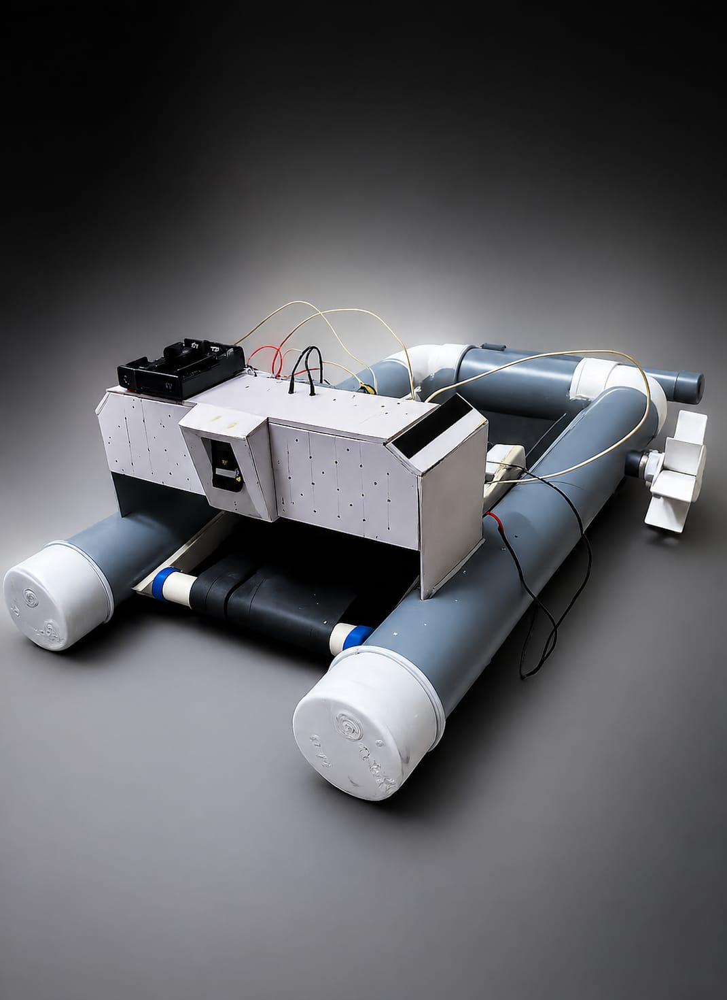
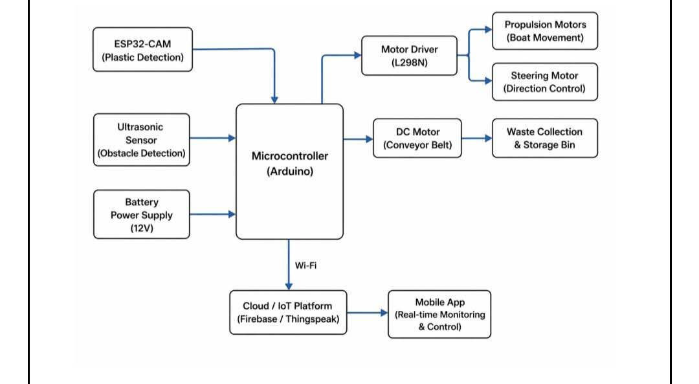
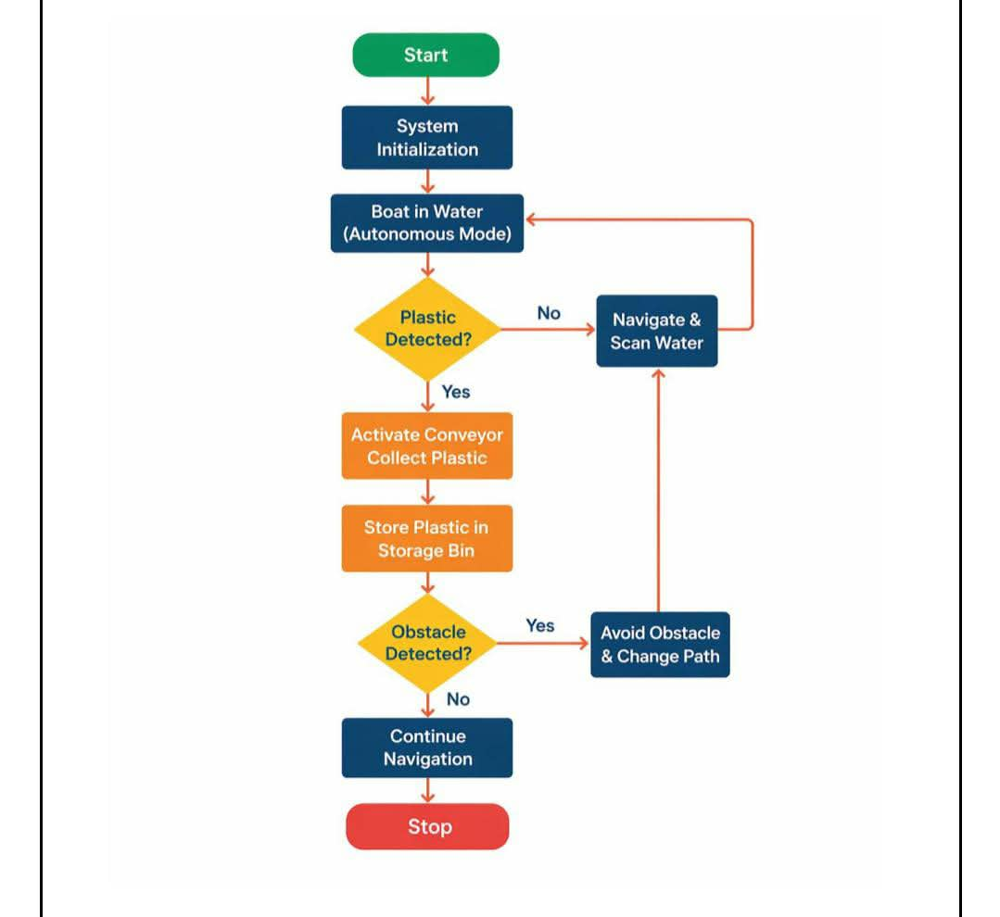

# Marine Water Cleaning Robotic Boat

## Project Prototype

*Prototype of an autonomous robotic boat designed for floating plastic waste collection in ponds and lakes.*

## Project Overview
The Marine Plastic Collecting Robotic Boat is an autonomous water-cleaning system designed to identify and collect floating plastic waste from ponds and lakes. The system integrates an ESP32-CAM (OV3660) with an Edge Impulse machine learning model for plastic and non-plastic classification. An Arduino UNO controls boat navigation, ultrasonic-based obstacle detection, and a motor-driven conveyor mechanism that collects detected plastic waste into an onboard storage bin. The project combines embedded systems, machine learning, robotics, and automation to support sustainable water-body cleaning.

## System Architecture

### 1. System Block Diagram

The block diagram illustrates the overall architecture of the robotic boat, including the ESP32-CAM, Arduino UNO, ultrasonic sensor, motor drivers, propulsion motors and waste collection mechanism.

### 2. System Flowchart

The flowchart represents the operational sequence of the robotic boat, including system initialization, plastic detection, waste collection, obstacle detection and autonomous navigation.

## Objectives

- Develop an autonomous robotic boat for collecting floating plastic waste.
- Implement plastic and non-plastic classification using ESP32-CAM and Edge Impulse.
- Automate waste collection using a motor-driven conveyor mechanism.
- Integrate ultrasonic sensing for obstacle detection and collision avoidance.
- Enable coordinated navigation and waste collection using Arduino UNO.
- Reduce manual effort in cleaning small water bodies.

  
## Hardware Components
Arduino UNO	
ESP32-CAM OV3660	
HC-SR04	
RS365 
Single-shaft BO motor	
L298N	
Single relay module	
Li-ion batteries
Buck converter	
Storage bin
  
## Project Outcomes

- Developed a robotic boat prototype for floating plastic waste collection.
- Integrated camera-based plastic and non-plastic classification.
- Implemented ultrasonic-based obstacle detection.
- Designed an automated conveyor-based waste collection mechanism.
- Demonstrated the application of embedded systems and robotics for environmental cleaning.

## Skills Demonstrated

- Embedded C/C++
- Arduino Programming
- ESP32-CAM Interfacing
- Edge Impulse
- Image Classification
- Sensor Interfacing
- Motor Driver Integration
- Robotics and Automation

## Software and Technologies
- Arduino IDE
- Embedded C/C++
- Edge Impulse
- Image Classification
- ESP32-CAM

## Working Principle

1. The ESP32-CAM captures images of floating objects.
2. The Edge Impulse model classifies the objects as plastic or non-plastic.
3. When plastic is identified, a detection signal is sent to the Arduino UNO.
4. The Arduino activates the conveyor motor to collect plastic waste into the storage bin.
5. The HC-SR04 ultrasonic sensor detects obstacles in the boat's path.
6. Based on the sensor readings, the Arduino controls the propulsion motors to change direction and avoid obstacles.
7. The boat continues navigating the water surface to search for additional floating plastic waste.

## Project Structure
- Arduino_UNO.ino - Motor control and navigation template.
- ESP32_CAM/ESP32_CAM.ino - Edge Impulse classification integration template.

## Applications
- Pond cleaning
- Lake cleaning
- Floating plastic waste collection
- Water body maintenance

## Future Improvements
- Automatic waste-bin-full detection.
- GPS-based navigation.
- Remote monitoring and control.
- Improved object detection and classification.

## Project Domain
Embedded Systems | Robotics | IoT | Artificial Intelligence
